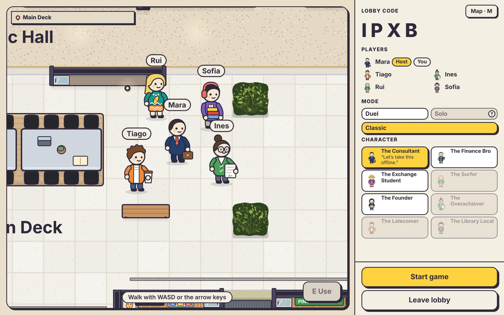
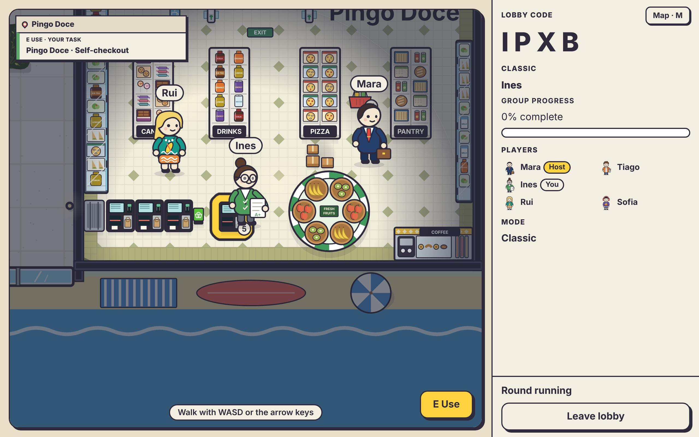
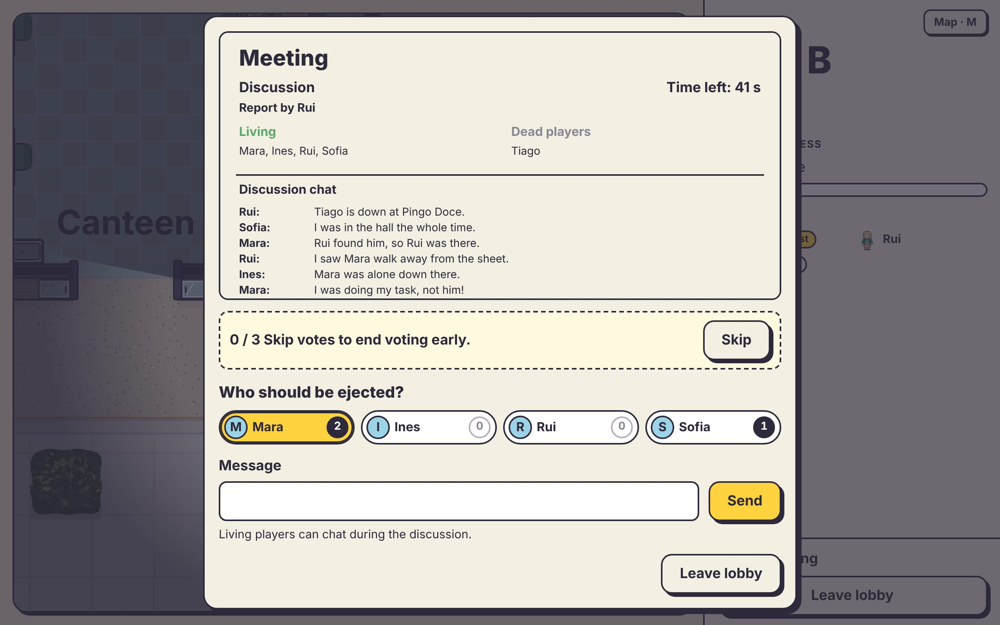
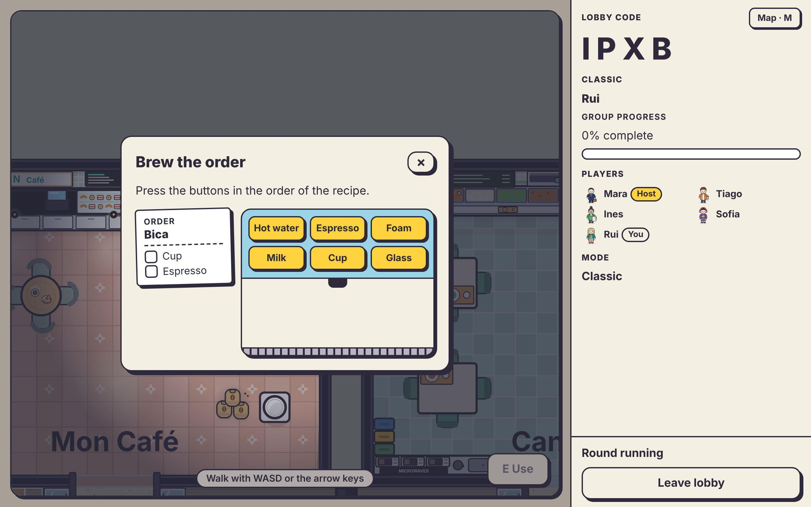
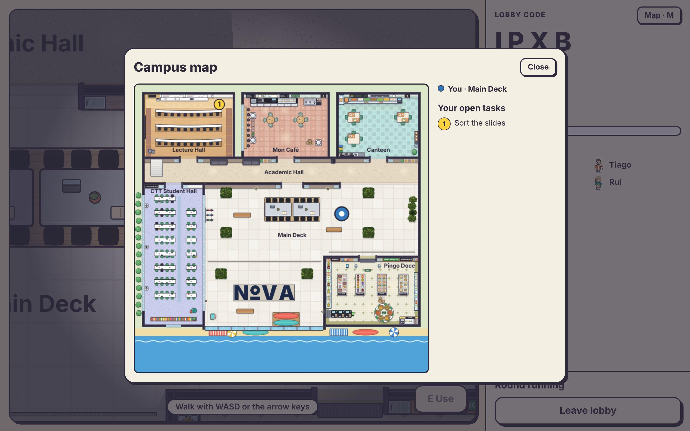

# Group Project

A multiplayer browser game set on the Nova SBE campus in Carcavelos. Everyone is working on the group project. One of you is only pretending.

Up to eight players join a lobby with a four-letter code. In the Classic mode the **High Performers** walk across the campus and complete tasks, each one a short minigame, while the hidden **Free Rider** pretends to work and quietly fails the others. Find the Free Rider and vote them out before the group project falls apart.

Team project for Introduction to Programming (course 2477), Nova SBE, 2026.

## Screenshots

Taken from the real game in Chromium, with five players in one lobby.


*The lobby: the code to share, the players and their characters, the mode and the character list.*


*Classic: limited view with fog outside it, the own active task in the card at the top left, and the station in range.*


*A meeting after a report: chat, public votes and Skip.*


*A minigame: “Brew the order” at the Mon Café station.*


*The campus map (key M): where you are and which station you need now.*

## Play it

**Deployed URL:** https://itp-group.onrender.com

The game runs on a free Render instance that goes to sleep when nobody visits. The first visit after a pause can take about a minute to load. To see several players at once, open the page in two or more browser windows (each window is one player).

## Team

| Name | Student number | Area |
|---|---|---|
| Hanna Schlesiger | 78153 | 1 Campus and characters |
| Felix Donder | 75246 | 2 Network, lobby, accounts, foundation |
| Laurin Dusel | 81263 | 3 Classic rules |
| Lennart Schmülling | 79898 | 4 Minigames and other modes |

## Run it locally

You need Python 3.13 or newer. Run all commands from the `game` folder.

Set up once:

```bash
python3 -m venv .venv && .venv/bin/pip install -r requirements-dev.txt
```

Start the game, then open http://localhost:8000:

```bash
.venv/bin/uvicorn server.main:app --reload
```

Without the environment variable `DATABASE_URL` the server keeps accounts and statistics in memory, so everything works locally and is gone after a restart. The deployed game reads `DATABASE_URL` from Render's settings and stores accounts and statistics in Postgres (Supabase).

Run the tests:

```bash
.venv/bin/python -m pytest
```

Check the dependencies for known vulnerabilities:

```bash
.venv/bin/pip-audit -r requirements.txt
```

About the tests: most of them are plain pytest. About 45 test files also run the real client files in Node.js (version 20 or newer), and about 28 (most of `tests/test_play_*.py` and a few others) drive real Chromium pages with the npm package Playwright. Without Node, or without Playwright and Chromium, pytest skips those files and says so; the rest still runs. The CI on GitHub has Node but no Playwright, so it skips the browser play tests; they are run on our own machines.

## The modes

| Mode | Players | What happens |
|---|---|---|
| Classic | 4 to 8 | Each High Performer has four tasks, one active at a time. The Free Rider (two with 6 to 8 players) fails players in reach and can hide. Failed players become ghosts. A found F-sheet or the red emergency button starts a meeting with chat and a public vote. The High Performers win when the progress bar is full or every Free Rider is out; the Free Riders win when they are as many as the High Performers. |
| Duel | 2 to 8 | Everyone gets their own random route across three task stations, of about the same walking length. The first to finish all three wins; after 3 minutes the round ends with a ranking. |
| Solo | 1 | The Duel alone, for practice. It counts for no statistics. A new lobby starts in Solo; when a second player joins, it switches to Duel. |

There are eleven minigames, one at each task station: Sort the slides, Brew the order, Build the tray, Shelve the books, Self-checkout, Fix the consultant's chart, Emergency caffeine protocol, Save the lunch, Decode the group chat, Expense the essentials and Seagull quality control.

Accounts (username and password, no email) keep rounds and wins per mode and the best Duel time; a leaderboard shows the best 20. Guests can play everything but have no statistics.

The status of every feature is in [game/FEATURES.md](game/FEATURES.md), the rules of every mode in [game/DESIGN.md](game/DESIGN.md).

## Known limitations

- A player whose connection drops cannot return to a running round; after signing in again they rejoin the lobby when the round is over (S-109).
- Lobbies and running rounds live only in the server's memory: a restart or a new deploy ends them.
- The log-in and lobby-code limits count per connection, so a new connection starts again at zero.
- If writing a round's statistics fails (the database is down or too slow), it is not tried again and that round's numbers are lost (S-211, M3-2.8).
- In Classic everybody learns at once who was failed (the victim's portrait is on the F-sheet, S-163); only the place of the sheet is sent just to those who see it (S-202).
- The character voted out is not shown drifting out to sea yet; the result is shown as text (M3-3.5).
- The browser play tests do not run in CI (see above).
- Not built, though planned "if time allows": the Deadline mode, sabotages, friends, sound and touch controls.

The open to-dos are in [game/TODO.md](game/TODO.md).

## The four areas

The work is split into four areas. Every file belongs to exactly one of them, and each area has one owner.

| Area | Owner | Responsible for | Code |
|---|---|---|---|
| 1 Campus and characters | Hanna | The map with its rooms, walking, collision, camera, limited view, characters, graphics | `game/client/js/world/`, `game/server/world/` |
| 2 Network, lobby, accounts, foundation | Felix | Server, WebSocket connection, message checks, lobby, accounts and statistics, page skeleton, tests, CI, hosting | `game/server/main.py`, `game/server/protocol.py`, `game/server/net/`, `game/server/accounts/`, `game/client/index.html`, `game/client/css/`, `game/client/js/main.js`, `game/client/js/net.js`, `game/client/js/lobby/` |
| 3 Classic rules | Laurin | Roles, failing someone, reporting, meetings, chat, votes, hiding, win conditions | `game/rules.py`, `game/server/classic/`, `game/client/js/classic/` |
| 4 Minigames and other modes | Lennart | The frame for minigames, all minigames, the Duel and Solo modes | `game/server/modes/`, `game/client/js/minigames/` |

## How it is built

| Part | Where | What it does |
|---|---|---|
| Server | `game/server/` | Python with FastAPI. Serves the page, holds one WebSocket connection per player, and decides everything that matters: roles, positions, who failed, votes, results, statistics. |
| Message checks | `game/server/protocol.py` | Every message from a browser is checked for size, shape and allowed values before any game code sees it. A rejected action gets one of the fixed texts in DESIGN.md, section 9. |
| Game rules | `game/rules.py`, `game/server/classic/`, `game/server/modes/`, `game/server/world/`, `game/server/accounts/statistics.py` | Plain functions without network, database or clock, so the tests can call them directly. |
| Client | `game/client/` | Plain HTML, CSS and JavaScript drawing on a canvas. No framework and no build step. It sends what the player wants to do and draws what the server reports. Each browser is sent only what its player may know (for example never who the Free Rider is). |
| Tests | `game/tests/` | pytest: accepted actions, rejected actions and edge cases, plus play tests in real browsers. They run on every pull request. |
| Data | Supabase (Postgres) | Accounts (passwords only as Argon2 hashes) and statistics. Lobbies and running rounds live only in the server's memory. |

No credentials are stored in this repository. The server reads the database connection from the environment variable `DATABASE_URL`.

## How we used AI tools

We built the game with coding agents (Claude Code), and we say so plainly: agents wrote most of the commits in this repository; the commits whose author is "Claude" are theirs, the others are our own. The team led the work and decided everything that mattered:

- We decided the game, its rules and its look ourselves; every decision is written down with its reason and who decided it in [game/DECISIONS.md](game/DECISIONS.md).
- Each piece of work started as a to-do in [game/TODO.md](game/TODO.md) and a brief with acceptance criteria. Agents in fixed roles (coder, reviewer, tester) built, reviewed and played it; since 2026-11-22 a small change is reviewed and played by the session that built it, and only a riskier one gets a separate reviewer; the process is in [game/WORKFLOW.md](game/WORKFLOW.md), the rules every agent follows in [AGENTS.md](AGENTS.md).
- Changes reach `main` through pull requests that a team member approved, with the tests green. Two commits on 2026-11-22 were pushed to `main` directly by mistake; their changes were checked and recorded afterwards (S-180, S-194).
- Each member owns one area (table above) and answers for the changes in it.

## Documents

- [game/WALKTHROUGH.md](game/WALKTHROUGH.md): a tour of the whole project: one message from key to screen, the four areas, the five rules, the questions we expect (data, tests, a database that is down, why, limits, security) and a checklist for the live demo
- [game/DESIGN.md](game/DESIGN.md): look, map, characters, screens, rules of every mode, minigames, every message shown to the player
- [game/DECISIONS.md](game/DECISIONS.md): every decision with its reason, including the ones we later replaced
- [game/FEATURES.md](game/FEATURES.md): every feature and its status
- [game/TODO.md](game/TODO.md): open and finished to-dos
- [game/WORKFLOW.md](game/WORKFLOW.md): how we work with coding agents
- [AGENTS.md](AGENTS.md): the rules every coding agent follows in this repository

## About this repository

The folder `archive/` holds an earlier idea of ours, the betting app "We Be(a)t", with its own lists and tests. We dropped it in favour of the game (S-01, S-45). It is not part of the deployed application.
