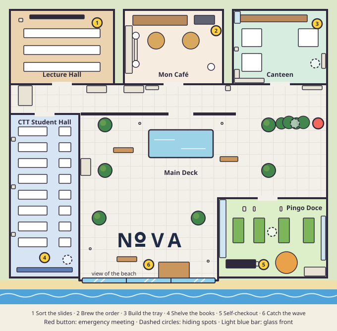
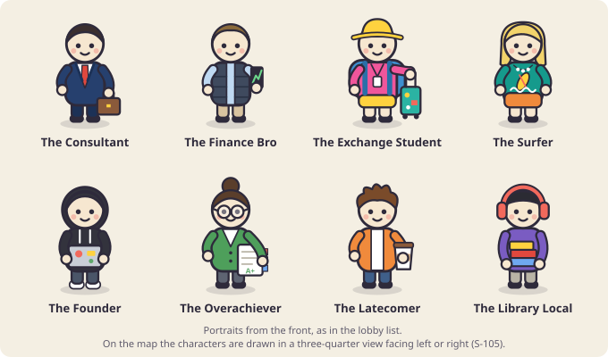

# Design “Group Project”

This is how the game should look and play. This document is a draft from 2026-11-18. Whatever the team confirms moves into [DECISIONS.md](DECISIONS.md) as a decision. Texts in the game are in English (S-43), so the names of characters, rooms and buttons are written in English here.

Everything without a note is required by Monday. “If time allows” means: only if all required parts work on Saturday (S-33).

## 1. Look

**Style:** Flat and seen from above, with thick dark outlines and strong, sunny colours. Everything is drawn with code (S-28), there are no image files. The look is deliberately our own: characters with a head, a body and one object, with no imitation of the game that inspired this one (S-02).

**Colours**

| Role | Colour | Use |
|---|---|---|
| Outline and text | `#2E2A3B` | all outlines, text |
| Background | `#EADFC8` (sand) | outside the buildings, page background |
| Surface | `#F4EFE3` (cream) | corridors, cards, dialogs |
| Accent | `#FFD23F` (sun yellow) | task stations, main buttons |
| Danger | `#F2695C` (coral) | Free Rider, emergency button, error messages |
| Success | `#5FA86B` (green) | progress bar, “done” |
| Water | `#9CD3E6` | fountain, links |

Every room has its own floor colour, so you know at once where you are: Lecture Hall wood-coloured, Mon Café light with a wooden counter, Canteen mint, CTT blue, Pingo Doce light green.

**Font:** The system font of the device, with headings in bold. No font has to be downloaded, which saves one dependency.

**Buttons and cards:** Rounded, with a dark outline and a hard shadow to the bottom right, like stickers. The most important button on each screen is yellow, all others are cream.

**Logo:** “GROUP PROJECT” in bold capital letters. One letter is coral red and hangs slightly crooked out of the row: the one who does not pull their weight.

## 2. Map

The map is based on the real campus in Carcavelos: light buildings, a large paved deck in the middle, a shallow reflecting pool, young trees in gravel beds and the beach at the bottom.

- Lecture Hall, Mon Café and Canteen are at the top. On the left, the CTT Student Hall stretches a long way down, and Pingo Doce is at the bottom right. The Main Deck lies between them.
- **Lecture Hall:** wooden floor, long white rows of benches, the board at the front.
- **Mon Café:** counter with a coffee machine, small tables and four columns like in the atrium.
- **Canteen:** serving counter and square tables.
- **CTT Student Hall:** tall and narrow, with eight rows of tables standing crosswise and the bookshelf at the end.
- **Pingo Doce:** four shelves and the self-checkout.
- **Main Deck:** reflecting pool, six trees, a hedge and the large NOVA logo. The red button for the emergency meeting stands to the right of the hedge. The sixth station is at the bottom, at the exit to the beach. You have to walk around all of these, and that is how players lose sight of each other.
- At the bottom, a glass front closes off the deck. You can see the beach and the sea, but you cannot go out.
- Every room has exactly one door to the deck and one task station (yellow dot). The stations are in the corners of the map, so that you really have to walk in Duel.
- You only ever see the section around your own character, about one room in size. The camera follows the character.
- If time allows: You cannot see through walls.

## 3. Characters

All characters are the same size and the same speed, they differ only in how they look (S-06). Each one has a body colour, a hairstyle or headwear and an object in the hand, by which you can recognise the character even when it is small. The faces are the same for all of them (S-07).

| Character | Colour | How to recognise the character | Line in the lobby |
|---|---|---|---|
| The Consultant | Dark blue suit | red tie, briefcase | “Let’s take this offline.” |
| The Finance Bro | Light blue shirt | quilted vest, phone with a price chart | “What’s the upside?” |
| The Exchange Student | Pink | yellow bucket hat, travel backpack, wheeled suitcase with stickers, lanyard | “Is this graded?” |
| The Surfer | Turquoise | long blond hair, shell necklace, surfboard printed on the shirt | “Waves were good, sorry.” |
| The Founder | Black hoodie | hood up, laptop covered in stickers | “We should pivot.” |
| The Overachiever | Green cardigan | glasses, hair bun, folder with tabs and “A+” | “I already started.” |
| The Latecomer | Orange jacket | messy hair, coffee cup, drops of sweat | “Did I miss anything?” |
| The Library Local | Purple hoodie | large headphones, stack of books in front of the body | “Shhh.” |

- Each character exists only once per lobby, so that players can be told apart. For this reason there are at most eight players in a lobby. The name is also shown above the character.
- When walking, the character bobs slightly and looks in the walking direction (mirrored).
- Failed players are half transparent and only visible to other ghosts.
- Where someone was failed, a crumpled sheet of paper with a red “F” stays on the ground until someone reports it.

## 4. Screens

| No. | Screen | Content |
|---|---|---|
| 1 | Start | Logo, “Log in”, “Sign up”, “Play as guest” |
| 2 | Sign up / Log in | Username, password, error message directly at the field. When signing up, the rules stand below the fields from the start: “3–16 letters or numbers” and “8–64 characters” |
| 3 | Home | “Create lobby” (yellow), “Join with code”, own profile, “Leaderboard”. If time allows: friends list with status |
| 4 | Lobby | Code in large letters for reading aloud, player list with characters, character selection. Characters taken by other players are greyed out. Until “Start game” exists, everyone in the lobby already walks on the map, with the lobby shown next to it. The host chooses the mode: “Duel” or “Classic”. A mode that is not built yet is greyed out with “Coming with the next milestone”; everyone sees the chosen mode. At the bottom right is the yellow button “Start game”, which only the host sees. It is grey as long as too few players are there, and below it there is then a text such as “Classic needs 2 more players”. All others see “Waiting for the host” in that place. While a round is running, the panel shows “Round running” instead of the character selection and the start button |
| 5 | Role reveal | Three seconds: “You are a High Performer” or “You are the Free Rider” in coral |
| 6 | Game | Map with displays, see below |
| 7 | Minigame | Window on top of the map, closes with Esc |
| 8 | Meeting | Cards of all players, chat, vote, clock |
| 9 | Vote result | Who received how many votes, the character drifts out to sea, and whether it was a Free Rider |
| 10 | End | Who won, who was a Free Rider, “Back to lobby” |
| 11 | Duel ranking | Placement with times |
| 12 | Profile | Rounds and wins per mode, best Duel time |
| 13 | Leaderboard | All accounts by wins. If time allows: filter “Friends” |

**Displays in the game**

- Top left: name of the room you are standing in.
- Top centre: progress bar of the group work.
- Right: your own task list with the room, finished tasks crossed out.
- Bottom right: large buttons “Use”, “Report” and, for the Free Rider, “Fail”. A button is grey as long as it would do nothing.
- Messages appear briefly at the top centre, errors in coral.

**How you notice that a key does something**

The same rule applies to E, R and Q. As soon as you stand close enough to a target (about one and a half character widths), two things happen at the same time:

1. The target gets a glowing border that pulses slowly.
2. The matching button at the bottom right changes from grey to colour. The button shows the key and the word that goes with it, for example “E Use”.

If you walk away, both disappear again. If two targets are in range, the closer one counts. There is no speech bubble above the target.

| Key | Target | Border | Button at the bottom right | Special note |
|---|---|---|---|---|
| E | Task station that is on your own list | Yellow | “E Use” | Stations that you do not need or have already finished do not glow |
| E | Emergency button | Yellow | “E Call meeting” | Only as long as you have not yet used up your meeting |
| R | “F” sheet | Coral | “R Report” | Visible to everyone who is in range |
| Q | High Performer in range | Coral | “Q Fail” | Only the Free Rider sees the border around the High Performer and the button. During the cooldown the button stays grey and counts down the seconds |

Pressing a key that would do nothing at that moment has no effect and also shows no error message.

**Controls**

| Key | Action |
|---|---|
| WASD or arrow keys | Walk |
| E | Use a station, press the emergency button |
| R | Report a failed player |
| Q | Fail someone (Free Rider only) |
| M | Overview map |
| Enter | Send chat in the meeting |
| Esc | Close the minigame or the map |

Every action also works with a mouse click on the button.

## 5. Classic mode

4 to 8 players. With fewer than 4, the round cannot be started.

1. Everyone starts on the Main Deck. Each player sees their role for three seconds. Two Free Riders also see who the other one is.
2. Each High Performer gets four of the five tasks, chosen at random. Every finished task fills the shared progress bar.
3. The Free Rider has a list of fake tasks. At a station, the Free Rider sees a loading bar that does not count.
4. The Free Rider can fail a High Performer who is in range. After that, the Free Rider has to wait 25 seconds, and 15 seconds at the start of the round. The Free Rider cannot fail another Free Rider.
5. Reporting happens right on the spot: For anyone who stands close to an “F” sheet, the button “Report” lights up (key R). Pressing it starts the meeting for everyone at once, and nobody has to walk anywhere. Without a find, everyone can call a meeting once per round with the red button on the right of the Main Deck, next to the hedge.
6. Meeting: 45 seconds of discussion by chat, then 30 seconds for the vote. You vote for one person or “Skip”. The person with the most votes goes, and nobody goes if there is a tie or a majority for “Skip”. Anyone who does not vote counts as “Skip”.
7. Whoever is voted out drifts out to sea: The character is caught by a wave on the beach, gets smaller and disappears on the horizon. A text says whether it was a Free Rider: “Mara was a Free Rider.” or “Mara was not a Free Rider.”
8. After the meeting everyone stands on the Main Deck again, and the Free Rider’s cooldown starts again.
9. Ghosts keep doing their tasks, but they do not write in the chat and do not vote.

| Value | Setting |
|---|---|
| Players | at least 4, at most 8 |
| Free Riders | 1 with 4 or 5 players, 2 with 6 to 8 |
| Tasks per High Performer | 4 |
| Cooldown “Fail” | 25 s |
| Discussion / vote | 45 s / 30 s |
| Emergency meetings | 1 per player |

**High Performers win:** The progress bar is full, or all Free Riders have been voted out.
**Free Riders win:** There are as many Free Riders left as High Performers.

If someone leaves the round, that player counts as failed, and their open tasks disappear from the progress bar.

In all modes, players walk through each other, and nobody can block a door.

**Hiding spots:** There are four marked places, shown on the map as dashed circles: in the aisle between the shelves in Pingo Doce, next to the bookshelf of the CTT Student Hall, in the corner of the Canteen and in the hedge on the Main Deck. Anyone who stands there is visible to others only from very close. Your own character becomes slightly transparent there, so that you notice that you are hidden. Everyone can hide, including the Free Rider.

If time allows: Sabotage “WiFi down”. The Free Rider locks all stations until someone restarts the router in the CTT Student Hall.

## 6. Duel mode

2 to 8 players.

1. For each player, the server draws their own three of the five stations in their own order. Nobody knows in advance where they have to go, and nobody knows the routes of the others.
2. Everyone starts on the Main Deck. Each player sees only their next station. The one after that appears only when the previous one is done.
3. To keep it fair, the server only draws routes whose walking distance is about the same length.
4. On the right edge, only the progress is shown for each player: 0/3, 1/3, 2/3, 3/3. You only see where the others are at the moment if you meet them.
5. Players do not block each other, they walk through each other.
6. Whoever finishes all three first wins. The round continues until everyone is finished or 3 minutes are over, and then the leaderboard with times is shown.

The win and the time go into the statistics (S-40).

## 7. Deadline mode (if time allows)

2 to 8 players. Everyone plays together, there is no Free Rider. The group has 5 minutes to finish three tasks per player. Every 45 seconds a random disruption comes. If the progress bar is full before the time runs out, everyone wins.

| Disruption | What happens | How to fix it |
|---|---|---|
| WiFi down | All stations are locked | Someone restarts the router in the CTT Student Hall |
| Power cut | The visible section shrinks to a small circle | Someone flips the fuse switch in the Lecture Hall |
| Fire drill | All minigames close | Everyone has to meet on the Main Deck within 20 seconds |
| Seagull | A seagull steals a tray, the station in the Canteen is locked | Someone runs after the seagull on the Main Deck and touches it |
| Queue at the canteen | The station in the Canteen is locked for 30 seconds | Wait, or do other tasks first |
| Deadline moved | The clock loses 20 seconds | Nothing, the group has to get faster |

## 8. Minigames

Every room has its fixed minigame, it does not change. But the content is shuffled anew every round. All minigames take 10 to 25 seconds, are played with the mouse only and have the same header: title, one sentence of instructions, close button.

After a mistake, only the wrong piece is reset, never the whole minigame.

A minigame opens with E or the button “E Use” at its station, only while a round is running. While it is open the character stands still. The close button and Esc close it without counting; it can be opened again and then has new content. When it is solved, the window shows “Done” in green for a moment and closes. A station whose minigame is not built yet shows “This task is still being built.” and a button “Finish task”.

| No. | Room | Title | Task | Done when | After a mistake |
|---|---|---|---|---|---|
| 1 | Lecture Hall | Sort the slides | Put five shuffled slides (Title, Agenda, Analysis, Results, Q&A) into the right order by dragging | all five are in the right place | the slide in the wrong place shakes and jumps back |
| 2 | Mon Café | Brew the order | An order slip names a drink with its recipe, for example Galão: Glass, Espresso, Milk. Press the buttons on the coffee machine in this order. There are six buttons: Cup, Glass, Espresso, Hot water, Milk, Foam | the drink matches the recipe | the wrong button flashes red, the steps so far stay |
| 3 | Canteen | Build the tray | There are six dishes at the counter. The order slip names four of them. Click these four onto the tray, the order does not matter | the four from the order slip are on the tray | the wrong dish goes back to the counter |
| 4 | CTT Student Hall | Shelve the books | Click six numbered books onto the shelf in ascending order | all six are on the shelf | the wrong book falls back onto the stack |
| 5 | Pingo Doce | Self-checkout | The checkout shows a target amount, for example €7.50. Six products with prices are on the belt. Scan as many as needed to get exactly that amount. A click on a scanned product puts it back | the total is exactly right | a product that takes the total above the amount is not accepted: “Unexpected item in the bagging area” |
| 6 | Glass front to the beach on the Main Deck | Catch the wave (if time allows) | A surfboard lies on the water, a wave runs through the picture from left to right. Click exactly when the wave is under the board | three waves have been caught | a wrong click only costs this attempt, the hits stay |

Minigame 6 is the only one with timing instead of sorting, selecting or calculating. It comes first of the “If time allows” minigames. As soon as it is built, everyone in Classic gets four of six tasks, and in Duel three of six stations are drawn.

**Sentences and names in the minigames**

- **Build the tray:** “Put the four dishes from the order slip on the tray.” The six dishes are Soup, Bacalhau, Rice, Salad, Pastel de nata and Fruit. The areas are labelled “Order slip”, “Counter” and “Tray”.
- **Brew the order:** “Press the buttons in the order of the recipe.” The slip is headed “Order”. A second press of the button that was just accepted is ignored, so a double click is not shown as a mistake.
- **Sort the slides:** “Drag the slides into the right order.” Five numbered places stand above the pile. A slide dropped on its right place stays there; on a wrong or filled place it shakes and jumps back; released outside the window it returns without counting.

About the drinks in minigame 2: Bica (Cup, Espresso), Abatanado (Cup, Espresso, Hot water), Meia de leite (Cup, Espresso, Milk), Galão (Glass, Espresso, Milk), Cappuccino (Cup, Espresso, Milk, Foam).

About minigame 5: The prices are multiples of 50 cents, and the target amount is always the total of three of the six products. So there is always a solution, and every combination that hits the amount counts.

After that, if time allows: “Stop the microwave” (Canteen), “Scan the attendance code” (Lecture Hall), “Fix the formula” (CTT Student Hall).

## 9. Messages and errors

Grading criteria 1 and 2 require that invalid input does not break anything and that errors are shown clearly. For this reason every rejected action has a fixed text:

| Situation | Message |
|---|---|
| Username taken | “That username is taken.” |
| Username or password too short or with characters that are not allowed | “Usernames are 3–16 letters or numbers.” / “Passwords need at least 8 characters.” |
| Wrong password | “Wrong username or password.” |
| Lobby code does not exist | “No lobby with that code.” |
| Lobby is full or round is already running | “This lobby is full.” / “This round has already started.” |
| Too few players for the mode | “Classic needs at least 4 players.” |
| Connection lost | “Connection lost. Reconnecting…” |
| Database not reachable | “Accounts are unavailable right now. You can still play as a guest.” |
| Host has left the lobby | “The host left. Mara is the new host.” |
| Password too long | “Passwords can have at most 64 characters.” |
| Password with a character that cannot be stored | “Passwords cannot contain that character.” |
| Lobby code is not four letters | “Lobby codes are 4 letters.” |
| Character already taken by another player | “That character is taken.” |
| Action that needs a signed-in player or a guest | “Log in or play as a guest first.” |
| Signing up, logging in or entering as a guest while signed in | “Log out first.” |
| Action that needs a lobby | “You are not in a lobby.” |
| Creating or joining a lobby while in one | “Leave your lobby first.” |
| Choosing the mode or starting the round without being the host | “Only the host can do that.” |
| Choosing a mode that does not exist or is not built yet (only when someone bypasses the page) | “That mode does not exist.” |
| Starting Duel with fewer than 2 players | “Duel needs at least 2 players.” |
| Choosing the mode, choosing a character or starting the round while a round is running | “This round has already started.” |
| Opening, closing or finishing a task while no round is running | “No round is running.” |
| Opening a station that does not exist or is not in use (only when someone bypasses the page) | “That station does not exist.” |
| Opening a station from too far away | “You are too far away.” |
| Opening a station that is not on your list or that you have already finished | “You do not need that station.” |
| Opening a station while a task is open | “Close your current task first.” |
| Closing or finishing while no task is open | “You have no task open.” |
| Reporting a task as done faster than it can be played | “That was too fast. Try again.” |
| The server fails while opening, closing or finishing a task | “Something went wrong. Try again.” |
| A minigame gets content from the server that it cannot show | “This task could not be loaded.” (shown inside the minigame window) |

## 10. What is deliberately not included

- No voice chat (S-10) and no chat outside of meetings.
- No characters with abilities, no skins to unlock.
- No sound, unless time allows.
- No phone controls, unless time allows (S-14).
- No email addresses and no “forgot password” (S-38).
