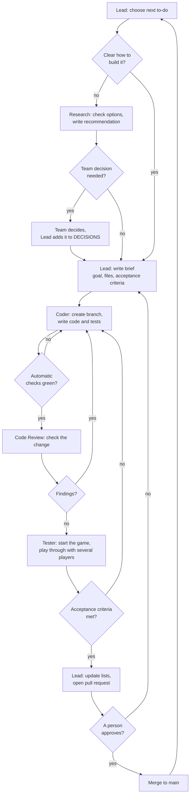

# Workflow with agents

This is how a to-do gets from the list to `main`. Rectangles are work steps, diamonds are decisions.

## The five roles

| Role | Task | May | May not |
|---|---|---|---|
| **Lead** | Keeps the overview. Chooses the next to-do, writes the brief, starts the other agents, decides at the diamonds, maintains TODO, FEATURES and DECISIONS, opens the pull request. | Change documents, start agents | Write game code, make team decisions alone |
| **Research** | Answers open technical questions before any code is written. Delivers half a page: options, recommendation, reasons, sources. | Read, search the web | Change files |
| **Coder** | Implements exactly one brief on its own branch, with tests for the rules. | Change files of its own area | Change files of other areas, extend the brief |
| **Code Review** | Reads the change and looks for bugs, rule violations and changes that reach into other areas. Receives the brief and the change, but not the Coder's explanation. | Read, report findings | Change code |
| **Tester** | Really starts the game, opens several browsers as different players and plays through the acceptance criteria. Delivers a report with screenshots. | Write tests under `game/tests/` | Change game code |

The Lead is the main session in which you talk to Claude, not a separate subagent (S-23). The other four are files under `.claude/agents/`: `researcher`, `coder`, `reviewer`, `tester`. The rules for all of them are in the `AGENTS.md` in the main folder.

## Process

## The steps in detail

1. **Choose a to-do.** The Lead takes the next open to-do from the TODO.md, in the order of the milestones. To-dos from different areas can run at the same time, because they affect different files.

2. **Diamond “Clear how to build it?”** For most to-dos the answer is yes, and then it goes straight to the brief. No means: there are several ways and the choice has consequences, for example when synchronising the player positions.

3. **Research.** The Research agent checks the ways and recommends one. It does not write code.

4. **Diamond “Team decision needed?”** If the recommendation affects more than this one to-do (a new library, a change to the message format, a new game rule), the team decides. The Lead adds the decision with its reasons to the DECISIONS.md. The Lead decides small things alone and records them as a “proposal”.

5. **Write the brief.** The Lead writes down for the Coder: the goal, the files it may touch, and the acceptance criteria as sentences that can be checked (“Three players see each other walk”). Review and Tester later measure the work against these criteria.

6. **Coder.** Creates a branch, writes the code and a test for every rule. It stays within the files of its area.

7. **Diamond “Automatic checks green?”** The syntax check and the rule tests run in seconds. If they are red, it goes straight back to the Coder. This way Review and Tester only get to see code that at least runs.

8. **Code Review.** The Review agent reads the change with fresh eyes. It checks: Is the logic correct? Does it fulfil the brief? Does it stay within its own area? Does the server reveal something to a client that the client is not allowed to know?

9. **Diamond “Findings?”** Every finding goes back to the Coder with file and line. Without findings it goes on to the Tester.

10. **Tester.** Starts the server, opens several browsers and plays as different players. It checks what the rule tests do not see: whether everyone really sees the same thing, whether something hangs, whether it is playable. The run is turned into a repeatable test, which from then on runs with every change. (The browser plays need Node with Playwright and Chromium; the CI on GitHub has no Playwright and skips them, so they run on our own machines.)

11. **Diamond “Acceptance criteria met?”** If not, the report with the steps to reproduce goes to the Coder.

12. **Lists and pull request.** The Lead ticks off the to-do, sets the feature to “Done” in the FEATURES.md, adds new decisions and opens the pull request with the test report.

13. **Diamond “A person approves?”** Someone from the team looks at the pull request and tries out the feature. If changes are requested, the Lead writes a new brief. Otherwise it is merged, and work continues with the next to-do.

## Rules for the loops

- Each of the three loops back to the Coder (checks, review, test) runs at most three times. After that the Lead stops and reports the problem to a person (S-25).
- After a fix that comes out of the test, the review also runs once more, but only on the new change.
- The Lead does not pass on reports unchecked. If the Tester reports “passed”, the Lead looks at the report and the screenshots before opening the pull request.

## How the four areas fit in

Every area has its own session with its own Lead and goes through the same process. Because every file belongs to exactly one area, the Coders do not get in each other's way. Only the message format in `server/protocol.py` is shared. It belongs to area 2, and every change to it is a team decision (step 4).
